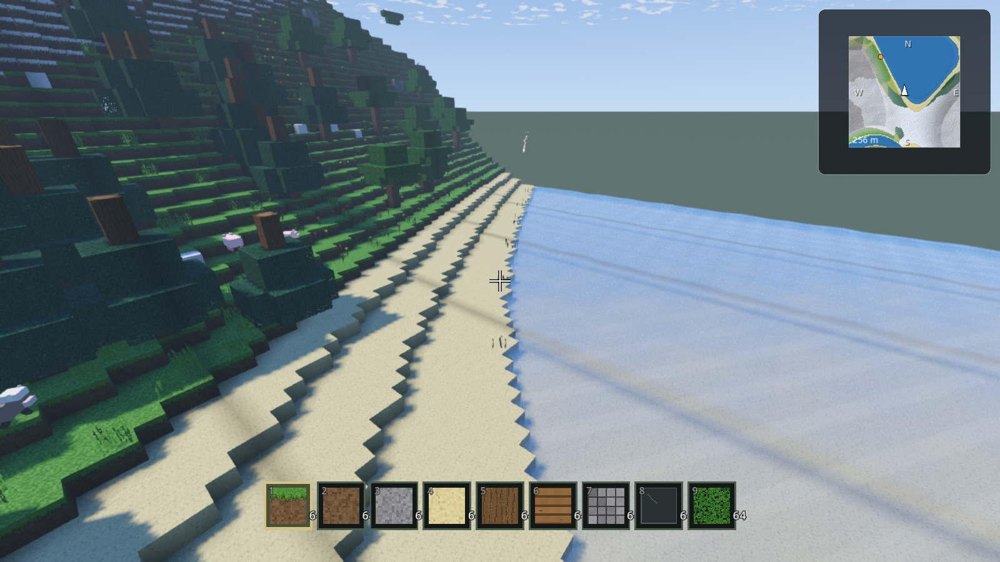
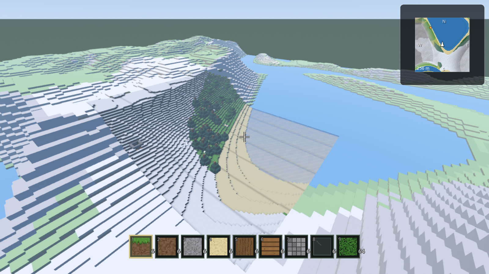

# Minecraft-like — a voxel survival sandbox in Godot 4.7 (C#)

A from-scratch, infinite-world voxel game built with **Godot 4.7.2 (.NET)** and
**C#**. It keeps the Minecraft loop — mine, craft, build, survive the night —
and adds a cozy-leaning survival layer: campfires that heal and repel hostiles,
an adaptive procedural soundscape, a live 3D main menu, photo mode, and an
event-driven first-hour survival guide.

The project is a long-running solo build with an extensive design log in
[`PLAN.md`](PLAN.md) and a forward roadmap in [`ROADMAP.md`](ROADMAP.md).

PRs #49–#57 are integrated on `integration/pr49-57`; the contribution map,
conflict resolutions, compatibility checks and measured validation are in
[`docs/INTEGRATION_PR49_57.md`](docs/INTEGRATION_PR49_57.md).

## Unified voxel material response

World surfaces and first-person held items share the response palette in
`scripts/MaterialResponse.cs`: stone, wood, soil, ore, foliage, glass, and
metal each have explicit roughness, metallic, and specular values. Procedural
atlas tile IDs are classified without changing persisted block/item IDs or
world-generation output. One C# response table configures all world shaders
and first-person materials. The mesher carries its compact family tag in vertex
colour alpha; greedy meshes retain their tile-array layer in UV2.x, so existing
merging, atlas UVs, and chunk streaming remain intact. Water-contact wetness is
encoded in the unused alpha-tag range without adding a vertex attribute.

The greedy texture array builds mipmaps from each isolated 32px tile rather
than the combined atlas. This avoids cross-tile colour bleed at distance.
The classic atlas path intentionally retains nearest sampling without atlas
mipmaps because generating mipmaps from the packed atlas would blend adjacent
tiles. Block-backed item icons remain AtlasTexture regions of this unchanged
atlas. Standalone procedural item icons are normalized into a centered 22px
silhouette frame inside their 32px image, with a one-pixel graphite contour,
a subtle upper-left-to-lower-right fill-light gradient, and four transparent pixels
of outer padding. Each standalone image owns its own five-level mip chain;
the first-person Sprite3D and its cached material use nearest-with-mipmaps
sampling to retain crisp pixels close up and reduce distant shimmer. The icon
finish runs only when a standalone texture is first requested; there is no
per-frame icon work or new scene-node system.

Rare and enchanted equipment extends this same 32px stack-icon pipeline. Common,
uncommon, rare and legendary bands are derived from the existing tool/armor/
weapon tiers and material identity; Sharpness, Protection and Unbreaking add
small, colour-coded pixel glints to the existing silhouette. Wear and quality
accents are composed before mipmaps are rebuilt, then cached by item, wear band
and enchantment family. Exact enchantment levels stay in the existing tooltip
and save fields. ItemDb.Icon(ItemStack) supplies the same cached result to
inventory, hotbar, cursor and first-person presentation. Block-backed items
still return the original AtlasTexture; their rarity is shown by a compact
marker drawn by the slot panel that already owns durability feedback.

## Transparency and cutout rendering

Foliage and crossed plants use the opaque atlas/texture-array shader with a
shared 0.5 alpha-scissor threshold, opaque depth writes for surviving texels,
and alpha-to-coverage under the project's MSAA setting. This keeps canopy and
plant silhouettes out of the transparent sorting pass. Glass and animated
water stay on dedicated alpha-blended chunk surfaces with `depth_draw_opaque`,
so translucent fragments do not overwrite the scene depth buffer. Both
transparent surfaces sort by their mesh AABB center rather than the chunk
origin; glass culls back faces while water remains visible from both sides.
Lava remains on its separate opaque, depth-writing emissive surface rather
than entering transparent sorting. The first-person held-item `Sprite3D`
retains texture alpha and nearest sampling so its icon edges stay consistent
with the procedural atlas.

The atlas/greedy-array/glass/water lighting shaders share a bounded sky/block blend:
torch light fills only the remaining skylight headroom, with a small shadow-gated
emission contribution. This prevents full daylight and torch channels from
being stacked into washed-out surfaces while retaining warm contrast at night
and in caves. New canopy tiles 56–58 are explicitly foliage, and every
placeable held item derives its first-person response from its registered block
atlas tile, preventing drift between the held sprite and placed geometry.

## Consistent block-edge shading

Cube corners, split cube faces, slabs and stairs now use the same half-voxel
corner sampler for baked sky/block light and ambient occlusion. AO checks the
actual 2×2×2 occupancy of neighbouring partial blocks instead of treating every
slab or stair as a fully occupied cube. Internal stair risers therefore shade
against the occupied half-cells that meet their edges, while unoccupied halves
do not create false dark corners.

The sampler is shared by the per-face path and the greedy face merge key, so
both renderers agree on corner values. The padded block and shape-state
neighbourhood also copies diagonal chunk corners; this keeps AO continuous at
four-chunk intersections rather than substituting a clamped cardinal edge.
Packed light is averaged from the same four corner-adjacent samples used by the
AO calculation.

This is a mesh-time shading correction, not a new lighting or art pipeline.
The existing greedy mesher, partial-face splitting, atlas coordinates,
texture-array tile layers/mipmaps, material-family tags and first-person
held-item response remain in use. It adds no vertex attributes, scene nodes,
runtime light nodes or per-frame scans; the additional occupancy and diagonal
snapshot work happens while a chunk mesh is built. The production capture scene
also includes a lower/upper slab and upright/inverted stair comparison row for
close and distant inspection:

```sh
godot --path . res://tests/WoodArtVisualCapture.tscn -- 1337 /tmp/edge-distant.png /tmp/edge-close.png
```

## Water-adjacent materials and shoreline vegetation

Faces that directly touch water keep their original material family and receive
a compact wet tag. The atlas and greedy-array shaders apply the same cool,
slightly darker response and softened roughness; dry faces retain their original
values. Grass, dirt, sand, gravel and farmland can use the treatment. The far
LOD applies the same tint when an existing coarse cell straddles the waterline,
using its four terrain-corner samples rather than additional noise queries.

New worlds use generator V11, which adds original procedural alpha-cutout river
reeds to shallow sand and grass shorelines. `BlockId.RiverReeds` 59,
`ItemId.RiverReeds` 108 and atlas tile 59 are appended; all prior IDs and atlas
coordinates remain unchanged.
V1–V10 generation remains frozen; this visual increment does not change save
format, voxel mutation APIs, greedy meshing or chunk streaming.

## Material test gallery

`res://tests/MaterialGallery.tscn` is a standalone Forward+ inspection scene for
every registered block ID. It lays the current 60 definitions into an 8×8
pedestal gallery, adds an ID/name legend, and captures the complete set at close
and distant camera scales. The scene uses a neutral display stage and fixed key /
ambient lighting so material families can be compared under one repeatable setup.

The fixture streams nine production `VoxelWorld` chunks with collision disabled
and a two-worker meshing limit. All sample voxel changes go through
`VoxelWorld.SetBlock`; the existing atlas, classic atlas shader, greedy
texture-array shader, lighting tags and block definitions are reused. The
streaming anchor has processing and physics disabled. Air is shown with a small
wire outline because it has no rendered surface; Bedrock is a display-only cube
using its registered face tiles and material response because `SetBlock`
intentionally rejects Bedrock placement. Neither exception changes world data
or weakens the gameplay mutation rules.

Run both renderer paths on a desktop with Godot 4.7.2 .NET:

```bash
GODOT=/path/to/Godot_v4.7.2-stable_mono_linux.x86_64
PATH=/path/to/dotnet:$PATH DOTNET_ROOT=/path/to/dotnet DISPLAY=:0 \
  "$GODOT" --path . res://tests/MaterialGallery.tscn -- 1337 \
  res://docs/visual/screenshots/material-gallery-close.png \
  res://docs/visual/screenshots/material-gallery-distant.png greedy

# Replace the final renderer argument with "atlas" to exercise the classic atlas path.
```

The runner accepts a seed, close output path, distant output path, and optional
`greedy` / `atlas` renderer override. It creates a disposable `user://tests/`
world, restores the previously selected world and meshing setting, and removes
the temporary directory on exit. The committed MX230 Forward+ reference frames
are [`material-gallery-close.png`](docs/visual/screenshots/material-gallery-close.png)
and [`material-gallery-distant.png`](docs/visual/screenshots/material-gallery-distant.png).
`MaterialGalleryTests` also checks complete ID coverage, unique sample positions,
face-to-atlas UV bounds, all 256 isolated mipmapped array layers, material
response ranges, block/item mapping, and the first-person block-icon atlas /
response mapping.

## Highlights

- **Infinite streaming voxel world** — 16×128×16 chunks, 13 terrain biomes,
  climate-shaped continents, smooth river valleys, mountain ranges, multi-form
  caves, aquifers, magma pockets, depth-aware ore veins, biome-specific trees,
  surface ruins and underground chambers. New worlds use generator V11, which
  preserves V10 terrain, structures, weathering and species canopies, then adds
  deterministic shoreline reeds. Generator versions 1–10 retain their frozen
  generation rules, golden chunk hashes and save compatibility.
- **Greedy meshing** — merged coplanar full-cube quads cut triangle count
  roughly in half; per-face meshing remains available for comparison. Vertex-light
  and AO samples are part of the merge key, preserving lighting boundaries.
- **Terrain material transitions** — original procedural grass has a deeper,
  irregular turf edge over exposed soil; farmland uses higher-contrast furrows
  and a defined tilled cap. Far-view terrain samples each block's upward-facing
  atlas tile, while coarse slopes retain a one-block surface cap over their
  dirt/stone substrate. Edited top-block materials (including farmland and
  exposed dirt) remain represented after chunk unload and save reload.
- **Architectural voxel building** — bottom/top/double slabs and four-way,
  upside-down stairs use a shared 2×2×2 occupancy definition for geometry,
  collision, ray selection and placement. Partial faces are split only at shape
  boundaries; full cubes retain the greedy path. Shape surfaces use the regular
  atlas, AO and voxel-light pipeline, with procedurally painted original textures.
- **Directional wood surfaces** — oak and birch logs have distinct, irregular
  end grain and vertical bark; oak planks use dedicated top, long-grain side and
  cut-end tiles. Slabs and stairs sample the same block-relative texel scale as
  full cubes, and stair grain follows its facing. The existing nearest-filtered
  atlas and texture-array materials remain in use, including the first-person
  held-item icon path. Greedy terrain's texture-array layers build isolated
  shared 2×2 noise detail units and isolated per-tile mip chains, retaining
  the 32×32 close-range pixel art while reducing distant shimmer and preventing
  mip-level bleed between atlas tiles.
- **Foliage and mineral surfaces** — existing oak and birch canopies use clustered cutout gaps and clearer leaf-tone groups; stone-family tiles receive deterministic low-contrast world-space tone variation, while ores use larger connected deposits for distant readability.
- **Shared material responses** — atlas, greedy texture-array and held-item surfaces use one roughness/metallic/specular palette for wood, soil, stone, ore, foliage, glass and metal.
- **Transparent and cutout surfaces** — foliage and cross-plants use depth-writing
  alpha scissor with alpha-to-coverage on the existing atlas/texture-array path;
  glass and animated water use separate alpha-blended chunk surfaces with
  opaque-only depth writes and mesh-bounds-center sorting. Glass culls back faces;
  water is two-sided. Both retain the existing atlas and voxel-light pipeline.
- **Voxel lighting** — packed 4-bit sky/block light, sunlight through transparent
  voxels, warm multi-source propagation with opaque occlusion, cave darkness and
  live place/break updates across chunk boundaries. Emitter edits incrementally
  add/remove block light in cached 3×3 regions; opacity edits invalidate the
  affected light maps so direct sun and cave spill are recalculated. Lighting is
  baked into mesh vertex channels; no per-torch light-node pool is required.
- **World presets** — normal, flat, amplified, and floating sky islands, with
  share codes and per-world seeds.
- **Survival** — health, hunger, breath, drowning, fall damage, softcore
  respawn, armor, tools with durability, fishing, farming, and cooking.
- **Block interaction** — material-specific hardness and tool speeds, harvest
  tiers and drops, creative instant mining, ten crack stages, block chips, and
  material-matched procedural breaking and placement sounds.
- **A living world** — species-specific sheep, cow, pig and chicken herds use
  distinct group sizes and spacing, react to danger, graze grass into dirt as
  hunger rises, and raise young that mature over time. Procedural articulated
  legs animate their gait; passive animals rest at night and seek overhead
  shelter during rain and storms. Briarbacks defend birch forests.
- **Equipment progression** — wood/stone/iron/diamond swords, bows and ballistic
  arrows, directional shields, weapon durability, critical strikes and
  knockback. Defeats award experience levels; a craftable Enchanting Table
  applies Sharpness, Protection and Unbreaking and upgrades tools and armor one
  tier while preserving durability and enchantments. Ember Warden trophies can
  be forged into an end-game Ember Blade. Legacy saves load with zero XP and
  unenchanted stacks.
- **Creature combat** — Shades and Rots coordinate detection, Hollows and
  Crystal Wisps telegraph dodgeable ranged shots, Cave Stalkers pounce from
  caves, and rare Dreadwings flank players at night; the Ember Warden remains
  the arena boss. A wandering trader, weather, lightning and ambient life
  complete the ecosystem.
- **Interface** — shared pixel-art menu, HUD, inventory, chest and furnace styling; viewport-aware panel scaling; slot hover feedback and tooltips; drag-and-drop and Shift-click stack movement. Durable equipment uses cached scuffed icon stages plus a green/amber/red condition meter across hotbar, inventory, armor and container slots.
- **First-person presentation** — the existing arm and held-item viewmodel use distinct mining, melee, placement, eating, bow-release, shield-block and landing profiles, layered with locomotion bob, idle breathing, climbing, swimming, bow draw and shield guard. Cached wear-state variants are reused by the selected-item icon; the item material/icon cache and camera attachment remain unchanged. Block targeting uses a paired unshaded dark silhouette and fine bright inset tracks, with cached cube/slab/stair geometry for readable contrast on snow, water and in dark caves.
- **Controller support** — left-stick movement, right-stick look, gamepad actions for mining/placing, hotbar cycling, inventory, pause, map and journal, with persistent button rebinding.
- **Quality of life** — minimap with zoom and waypoints, achievements journal,
  keyboard/controller rebinding, accessibility toggles, photo mode, dev console,
  and an automatic quality governor.
- **First-hour guidance** — a contextual, per-world 15-step survival guide
  teaches movement, gathering, crafting, mining, food, shelter, furnace use,
  combat, caves, villages and the first night. Steps are completed by successful
  gameplay events rather than starter-kit inventory, and progress is retained
  in the existing world flags.
- **Deterministic saves** — per-world folders, atomic writes, rotating backups,
  and byte-parity anchors so old worlds never change under new worldgen. Save
  format v4 adds optional block-shape state, villager and quest records, and
  boat state; v1-v3 worlds load with defaults and generator versions remain
  unchanged.
- **Portable world management** — checksummed ZIP export/import, duplicate-name
  handling, staged imports with path-traversal and archive-expansion protection,
  backup browsing and safe restore, and per-world playtime/size metadata.


## World management and portability

Open **Play** and choose **Manage** on a world to view its seed, generator
version, cumulative playtime, last-played timestamp, disk size, and available
restore points. **Backups / Export** lists the rotating save snapshots and
restores a selected valid snapshot only after confirmation; the current file is
preserved as a safety backup during restoration.

Use **Export ZIP** to create a portable archive containing the complete world
folder, metadata, and available save backups. Use **Import ZIP** from the world
selection screen to validate and import an archive. Imports are extracted to a
staging directory, checked against the archive's SHA-256 file index, and only
then moved into the worlds folder. Existing worlds are not overwritten; a
name suffix is assigned when an imported world has a duplicate name. Archives
with unsafe paths, links, unsupported save/generator versions, corrupt data
without a valid backup, or excessive expanded size are rejected.

Older manifests without a playtime field continue to load with zero playtime;
existing world-save versions and generator versions are not rewritten by import.

## Requirements

- [Godot 4.7.2 **.NET / mono**](https://godotengine.org/download) editor.
  The standard (non-.NET) editor cannot run C# projects.
- [.NET 9 SDK](https://dotnet.microsoft.com/download) (`global.json` pins the
  feature band and rolls forward within .NET 9).

## Build and run

```bash
dotnet build
godot --path .            # run the game
godot --editor --path .   # open the editor instead
```

You can also open `project.godot` from the Godot project manager and press
**F5**. The first launch creates `user://worlds/` under the Godot user data
directory (`~/.local/share/godot/app_userdata/minecraft/` on Linux).

## Tests

The test suite runs inside a headless Godot instance:

```bash
GODOT=/path/to/Godot_v4.7.2-stable_mono_linux.x86_64 ./scripts/verify.sh
```

`scripts/verify.sh` builds the project and runs
`res://tests/TestRunner.tscn`; it exits non-zero on failure or on the default
300-second test timeout. The timeout can be changed with
`GODOT_TEST_TIMEOUT=seconds`. The runner prints one line per suite and a final
check/failure count. If `GODOT` is unset, the script looks on `PATH` and in
common install locations.

For a rendered item-quality review, launch `res://tests/EquipmentDurabilityVisualCapture.tscn`
with the Godot 4.7.2 .NET editor or executable. It uses the production `InvSlot`
control and shows common through legendary gear, plain and enchanted examples,
and full / 74% / 49% / 24% durability states. The PNG is written to
`user://equipment-durability-visual-validation.png`.

The current headless suite reports **189,870 checks, 0 failures across 47
suites**, with 0 Debug build warnings or errors. The added
`item-visual-quality` suite pins rarity bands, cached enchantment variants,
wear/enchantment composition, first-person visual-state signatures and block
atlas-region compatibility. Loop-based worldgen scans can vary by a few
checks between runs, but zero failures is required. The selection-outline suite
adds 275 checks for two-pass contrast materials and cube/slab/stair geometry,
including every partial-block state. `integration-regressions` pins V9, V10 and
V11 golden chunk hashes, runs V11 forward and reversed chunk order across
positive and negative coordinates, proves the V11 delta is only air-to-reed
cells, round-trips appended reed content through V4 saves, and checks the wet
merge bit directly. Coverage also includes deterministic V9 weathering,
the V10 foliage-only delta, the V10-to-V11 shoreline-only delta,
V8-to-V9 chunk-diff and chunk-order regressions,
atmosphere/weather/water presentation, the performance runner, streaming memory
accounting, the combined save round-trip (shapes + villagers + quests + boats),
graphics-preset migration, render-only mesher collision checks, quest reward
wiring, fluid/shape boundaries, legacy saves, every pinned block/item ID and
V1–V8 golden chunk hashes. The headless runner and a verbose real-scene soak both exit without
leaked ObjectDB instances or RIDs. The project-specific reliability audit,
including seven confirmed fixes and the remaining manual-coverage gaps, is in
[`docs/RELIABILITY_AUDIT_2026-11-21.md`](docs/RELIABILITY_AUDIT_2026-11-21.md).

### Gameplay polish — Milestone 5 increment

The existing first-night hint chain has been expanded into a contextual
15-step first-hour guide. It observes successful player actions (block breaks,
crafting, food gathering/eating, block placement, furnace use and resident
interaction), natural cave entry, hostile defeats and the night-to-dawn
transition. The guide preserves the previous `onboard/wood`, `table`,
`pick`, `stone`, `torch`, `night` and `done` flags; new facts use the
existing world flag dictionary, so no save-version migration is required.
Shelter progress counts placed solid blocks, not torch placement or farmland
tilling.

Quest objective completion now emits an event consumed by the HUD to announce
stage advancement and completion, while reward claims remain in the existing
transactional quest path. The pause input policy also leaves Escape/back to the
keybind modal while it is open above the pause menu. Regression coverage is
included for the onboarding action rules, quest stage events and nested modal
input policy.

Validation on Godot 4.7.2 .NET / .NET 9:
- Debug build: 0 warnings, 0 errors.
- Release build: 0 warnings, 0 errors.
- `scripts/verify.sh`: **189,838 checks, 0 failures**.
- First-person animation profiles and pose envelopes have automated coverage;
  rendered pose sign-off on the MX230 and physical controller action review
  remain manual. Boat handling and broader village/trading usability also
  require interactive playtesting.

Implementation notes and remaining Milestone 5 scope are in
[`docs/GAMEPLAY_MILESTONE_5.md`](docs/GAMEPLAY_MILESTONE_5.md).

### Performance benchmarking

An opt-in runner at `res://tests/PerformanceRunner.tscn` benchmarks the real
main scene with a disposable V8 world and deterministic routes for open
terrain, dense forest, mountain/river, villages, caves, ocean, storms, hostile
encounters and fast exploration. It exports a JSON summary plus per-frame CSV
under `user://benchmarks/`. The report includes frame-time percentiles,
Godot process/physics timings, process/managed memory and GC, VRAM, draw calls,
mesh-build distribution, chunk counts and queue high-water marks. It does not
write to the selected player world.

See [`docs/PERFORMANCE_BENCHMARKS.md`](docs/PERFORMANCE_BENCHMARKS.md) for
arguments, repeatability requirements and interpretation. Headless runs are
for lifecycle smoke tests only, not rendered performance measurements.
Older `docs/PERF_BASELINE.md` figures remain historical; the RTX 4060 comparison
is still pending.

The MX230 controlled Release comparison for Milestone 2 is recorded in
[docs/PERFORMANCE_MILESTONE_2_MX230.md](docs/PERFORMANCE_MILESTONE_2_MX230.md):
three matched runs show approximately 9% higher median FPS in both open terrain
and heavy rain. These results apply only to the measured configuration and
should not be generalized to other GPUs or presets.

### Performance Milestone 3 — bounded streaming and memory accounting

Chunk meshing now reserves capacity before building a payload. A cancellable
`SemaphoreSlim` replaces worker-side polling/sleep backpressure, bounding
in-flight payload work to 18 items (including completed payloads waiting for the
main thread). Scene teardown cancels blocked workers, waits for the worker
batch, drains both apply queues and returns remaining payloads to the existing
pool. Main-thread application prioritizes edit rebuilds and targets 2 ms per
frame, always allowing one payload to make progress.

The runtime profiler records pending payload counts/estimated bytes and their
high-water marks, exact managed voxel-cache array bytes, a view-distance-aware
cache budget, edit/light metadata estimates, applied mesh source-array estimates,
retained pool-buffer bytes, main-thread apply timings and collider timings.
Metadata and mesh values are estimates; Godot driver allocations and VRAM are
not represented as exact byte counts. The cache budget is a guardrail for
managed voxel arrays, not a whole-process memory limit.

Validation on Godot 4.7.2 .NET:
- Debug and Release builds: 0 warnings and 0 errors.
- `scripts/verify.sh`: 4,283 checks, 0 failures.
- Benchmark matrix: 54/54 runs passed across nine scenarios in Debug and
  Release.
- Thirty-minute real-scene survival soak: PASS at 1,800 seconds; peak RSS
  304.1 MiB, peak managed memory 57.1 MiB, voxel-cache arrays 4.2 MiB against
  an 18.9 MiB budget, payload high-water 14/18, 0 invalid creature positions,
  0 orphan nodes, successful save/reload and temporary-world cleanup.
- Rendered Forward+ visual review selected the NVIDIA GeForce MX230. The real
  survival scene streamed cave geometry with the HUD and minimap; a second
  production-scene V8 surface capture at seed 1337 / center (512,-372) rendered
  49 chunks at 1600×900. Both captures are committed under
  `docs/performance/screenshots/` and documented in the milestone report.

Detailed implementation, measurement definitions and run conditions are in
[`docs/PERFORMANCE_MILESTONE_3_STREAMING.md`](docs/PERFORMANCE_MILESTONE_3_STREAMING.md).

### Reliability audit

The 2026-11-21 audit found and fixed seven defects that ordinary smoke testing
missed: boat-death respawn stranding, duplicate mob death rewards, non-stackable
inventory overflow, campfire food deletion on a full inventory, world-delete
path traversal, stale villager state at quit-time saves, and modal input
stacking. Each fix has a headless regression except the input-ordering guard,
which is covered by code-path review. Details, severities and unresolved
suspicions are in
[`docs/RELIABILITY_AUDIT_2026-11-21.md`](docs/RELIABILITY_AUDIT_2026-11-21.md).

## World-generation visual validation

V8 was inspected in the real 3D game scene using Godot 4.7.2 .NET, Forward+
Vulkan rendering and an NVIDIA GPU. Baseline and V8 captures use matching
coordinates for a steep river bank, river valley, mountain, forest and cave
region. The paired images and findings are in
[`docs/worldgen/V8_VISUAL_VALIDATION.md`](docs/worldgen/V8_VISUAL_VALIDATION.md).

V9 weathering was captured in the real game scene on the NVIDIA GeForce MX230
using Godot 4.7.2 .NET and Vulkan Forward+. The fixed seed 1337 ruin at
(429,54,-1893) was captured at close and distant camera scales; the two frames
are committed in docs/worldgen/screenshots/. Both use the existing chunk
streaming, atlas materials and greedy mesher. Findings and hardware details are
in [`docs/worldgen/V9_VISUAL_VALIDATION.md`](docs/worldgen/V9_VISUAL_VALIDATION.md).

Capture another seed/coordinate from the real scene with:

```bash
godot --path . res://tests/WorldgenVisualCapture.tscn -- 1337 9 429 -1893 res://docs/worldgen/screenshots/custom-v9.png 0.32
```

Arguments are seed, generator version, world X, world Z, output PNG path and
optional camera scale (0.2–2.0; smaller values move the inspection camera
closer). The capture scene waits for surrounding chunks to stream before
saving the 1600×900 viewport image.

## Environment and water visual validation

The environment polish pass adds a deterministic dawn/day/dusk/night palette,
biome-aware rain/snow transitions, and world-space water depth with restrained
shoreline foam. It extends the existing day/night, weather and water shader
systems without changing save formats, persisted IDs, world generation, voxel
lighting propagation, greedy meshing or chunk streaming.

Run a fixed real-scene Forward+ atmosphere capture with:

```bash
godot --path . res://tests/AtmosphereVisualCapture.tscn -- 1337 8 512 -372 0.50 Clear res://docs/visual/screenshots/atmosphere-river-valley-noon-clear.png
```

Arguments are seed, generator version (1–11 on current main), world X/Z, time of day, weather
(`Clear`, `Cloudy` or `Rain`) and output PNG path. The separate
`WorldgenVisualCapture` also accepts optional camera scale (0.2–2.0) and far-LOD
radius in metres after its output path. The runner creates and removes a
disposable world. Matching V8 and V9 MX230 samples and the remaining manual
capture matrix are documented in
[`docs/VISUAL_MILESTONE_4_ENVIRONMENT.md`](docs/VISUAL_MILESTONE_4_ENVIRONMENT.md).

### Water-adjacent visual validation

The V11 shoreline was captured in the production main scene on the NVIDIA
GeForce MX230 using Godot 4.7.2 .NET, Vulkan Forward+ and a 1600×900 viewport.
Both captures use seed 1337 around world coordinate `(558, -478)`, where a
reed grows on a sandy bank beside source water. The close frame uses camera
scale 0.20; the distant frame uses scale 1.00 and a 256 m far-LOD ring.
Both settled with 49 streamed chunks and saved successfully. The images are
committed below for repeatable review:





The real-scene loader reports pre-existing invalid resource-UID fallbacks for
several scene scripts and resolves them through their tracked `res://` paths;
these did not prevent either capture. No shader compilation or rendering errors
were reported. The captures validate this seed and camera setup, not every
biome, weather and graphics-preset combination.

### Long-duration survival soak

An opt-in integration runner loads the real main scene in Normal Survival and
exercises naturally spawned herds, feeding/breeding, hostile encounters, cave
fauna, weather and day/night cycles. It uses an isolated
`user://tests/survival-soak-*` world, verifies the world/player saves can be
read back, then removes that temporary directory; it never saves over the
player's selected world. Population and cave-encounter counts are logged every
minute. Run a 60-minute soak with:

```bash
GODOT=/path/to/Godot_v4.7.2-stable_mono_linux.x86_64 bash scripts/soak-survival.sh 3600
```

Use `300` for a five-minute smoke run. The runner reports PASS only when it
finds a generated cave, records cave encounters, successfully feeds the natural
herd and observes a juvenile, retains a live passive population, reads back
both save files, and removes the temporary world. It reserves the final two
hotbar slots for wheat and seeds because a new-world starter kit occupies all
nine hotbar slots and normal `Inventory.Add` then places food in the backpack,
which cannot be selected for animal feeding.
The runner uses the real main scene, but fixes its test-only graphics load
to LOW, a two-chunk view radius, three meshing workers, and no far-LOD ring.
This avoids turning a gameplay soak into an accidental MAX-preset streaming
stress test on a small CI host. World generation, colliders, Jolt physics,
survival rules, mob AI, feeding/breeding, weather, day/night and save handling
remain enabled. It also caps the uncapped headless render loop at 60 FPS to
avoid saturating the Godot 4.7.2 Jolt job pool; it does not use fixed-FPS
simulation, so survival time remains real-time. The script bounds runtime to
duration + 300 seconds by default; override that with
`SOAK_TIMEOUT_SECONDS`. The soak remains separate from the fast headless
suite and is not a human combat or visual gameplay playtest.

The Milestone 3 run additionally gates pending-payload bounds and shutdown
drain, managed voxel-cache array memory, save/reload, temporary-world cleanup,
and finite creature positions. The completed 30-minute result and its memory
measurements are recorded in
[`docs/PERFORMANCE_MILESTONE_3_STREAMING.md`](docs/PERFORMANCE_MILESTONE_3_STREAMING.md).

## Controls

| Input | Action |
|---|---|
| `WASD` | Move |
| `Space` | Jump / swim up / climb (double-tap to fly in creative) |
| `Shift` | Sprint / dive |
| Mouse | Look |
| Left mouse | Mine / attack (hold to keep; release or change target to cancel) |
| Right mouse | Place / use / eat / cook / rest / tame |
| Middle mouse | Pick block |
| `1`–`9`, mouse wheel | Select hotbar slot |
| `E` | Inventory / crafting |
| `Esc` | Pause menu |
| `M` | Minimap · `[` / `]` zoom |
| `P` | Photo mode (arrow keys scrub time) |
| `J` | Achievements journal |
| `H` | Help overlay |
| `F3` | Info panel |
| `F6` | Cycle quality preset |
| `F7` / `F8` | View distance down / up |
| `F9` | Mute sounds |
| `/` | Dev console |

Bindings are rebindable from **Esc → Controls**. Keyboard and controller
bindings are stored separately; the controller map is additive and never
erases a keyboard binding.

| Controller | Action |
|---|---|
| Left stick | Move |
| Right stick | Look |
| `A` | Jump / swim up |
| `B` | Toggle creative flight |
| `Y` | Inventory |
| `Start` | Pause |
| Left shoulder | Place / use |
| Right shoulder | Mine / attack |
| Right stick click | Pick block |
| D-pad left / right | Previous / next hotbar slot |
| D-pad up / down | Minimap / achievements journal |

Menus support controller focus, confirm and cancel. Keyboard and controller buttons are configured separately and persist in `user://keybinds.cfg` and `user://gamepad.cfg`.

**Controller defaults:** left stick moves, right stick looks, A jumps, B toggles creative flight, left/right shoulder place/mine, right-stick click picks a block, Y opens inventory, Start pauses, D-pad left/right cycles the hotbar, and D-pad up/down opens the map/journal.

Inventory supports click-to-pick/place, right-click half-stack splitting, Shift-click quick transfer, and drag-and-drop between player, chest, crafting and furnace slots.

## Fluid behavior

Source water remains full-height. Water spreads downward and outward through
seven progressively shallower flowing levels. Falling columns form continuous
waterfalls; unsupported flow recedes, solid terrain blocks propagation, and
plants/torches are displaced. Water touching lava converts the lava to the
existing cobblestone reaction block; lava itself remains static, viscous, and
damaging rather than behaving like water.

The fixed-step simulator examines a small window of already-streamed chunks
around the player and commits at most six edits per tick through
`VoxelWorld.SetBlock`. It does not generate chunks, alter terrain generation,
or scan the world. Swimming uses buoyancy and smooth acceleration: Space swims
up, Shift dives, shallow water slows wading, and head submersion controls breath
loss. Breath recovers above water; mining is slower while fully submerged.

### Buckets and boats

Buckets are unstackable inventory items. An empty bucket collects only a true
source-water or lava cell; flowing water cannot be scooped. Filled buckets
place a new source into a loaded, replaceable voxel and become empty again.
Both operations use `VoxelWorld.SetBlock`, so edits continue through the
existing save, lighting, and meshing path. Craft a bucket from three iron
ingots in a V; craft a wooden boat from five planks in a U.

Place a wooden boat on a loaded water surface. Right-click a nearby boat to
board, use WASD to accelerate and steer, hold Shift to brake, and press Space
to dismount to a nearby clear cell. The boat samples the existing source and
flowing-water heights for buoyancy, collides with streamed terrain, and stops
before any part of its hull can enter an unloaded chunk. Boat position,
heading, velocity, and rider state are optional world-save fields; older
worlds load without a vehicle list.

## Project layout

| Path | Contents |
|---|---|
| `scripts/` | Gameplay and engine code (C#), plus `verify.sh` |
| `scenes/` | `main.tscn` (game) and `main_menu.tscn` |
| `shaders/` | Water shader |
| `tests/` | Headless test runner, suites, and GPU-backed wood-art capture scene |
| `docs/` | Performance baselines, benchmark procedure and audits |
| `addons/godot_ai/` | Editor MCP assistant addon (development tooling) |
| `PLAN.md` | Completed milestone log (M0–M4b) |
| `ROADMAP.md` | Forward plan (M5–M10) and progress log |

For a production-renderer inspection of directional wood textures, run
`godot --path . res://tests/WoodArtVisualCapture.tscn -- 1337`. It builds a
disposable test world through `VoxelWorld.SetBlock` and writes close and distant
captures to `user://wood-art-validation-close.png` and
`user://wood-art-validation-distant.png`. This is a manual visual check rather
than part of the headless test suite; run it with the same Godot renderer and
hardware profile you intend to validate.

## Combat equipment and enchantments

Survival combat includes tiered swords, a bow with gravity-driven arrow projectiles,
front-facing shield blocks against melee and ranged attacks, and armor mitigation.
Mob defeats award experience; Crystal Wisps remain a renewable lapis source, and
the wandering trader now sells one lapis for two gold ingots as a predictable
fallback. Craft an **Enchanting Table** from two diamonds, two iron ingots, and
one lapis lazuli; right-click it to open the dedicated station. Its **Enchant /
Upgrade** panel applies Sharpness, Protection, and Unbreaking (I–III) using
experience levels and lapis, and upgrades supported gear while preserving its
remaining durability and enchantments. Failed trades do not consume currency
when the output cannot fit in the inventory.

The progression is wood → stone → iron → diamond, with mining harvest gates
preserved: stone picks unlock iron ore, while iron picks unlock gold and diamond
ore. Ore is depth-banded with seeded V7 veins; mountains have denser gold and
diamond hash sampling. Ore atlas deposits use larger stepped mineral clusters
with restrained edge shading and highlights so the four resources remain
distinct at cave depth and at distance. Ore stays fully opaque and emits no
block light; solid cave walls continue to hide valuable veins. One coal burns
for 80 seconds and smelts eight items at
ten seconds each; logs burn for 60 seconds, planks for 15, and sticks for five.
Furnace updates carry elapsed time across fuel boundaries, including larger
frame steps. Raw meat is low-value food; cooked meat restores 5–7 hunger and
heals one health, and bread offers a farmable five-hunger/one-health option.

Armor points reduce physical damage by four percent per point, capped at 80%
base mitigation; Protection then reduces the remaining damage by four percent
per enchantment level on each piece. Unbreaking I/II/III prevents 50%/66.7%/75%
of equipment wear. Full iron armor has 15 points (60% base
reduction) and full diamond armor has 20 (80%). Starvation and drowning bypass
armor mitigation and do not wear armor. Other landed physical/environmental hits
wear equipped armor; successful shield blocks wear the shield. Tools used as
emergency melee weapons also consume their durability on a landed hit.

Equipment condition is visible without reading a number: tools, weapons and armor
use the same original 32×32 procedural icon with three cached scuff stages as
condition reaches or falls below 75%, 50% and 25%. Inventory, hotbar, armor and
container slots also draw a crisp three-pixel meter (green / amber / red); worn
values remain beside the icon, and the tooltip always shows current / maximum.

A shared quality language distinguishes common gear, uncommon iron/gold/lapis,
rare diamond equipment and legendary Warden rewards. Rare and legendary icons
receive restrained cyan or ember pixel facets; enchanted stacks add icy
Sharpness, violet Protection or warm-gold Unbreaking glints without changing
the icon silhouette. The same accent palette appears as a four-pixel rarity
pin in the existing slot draw pass, including for rare block-backed materials.
The first-person held item uses the identical cached quality/wear texture and
refreshes when enchantments change even if its item ID stays the same, while
retaining its registered material response. Block-item icons continue sampling
their unchanged atlas region. Icon variants are painted and mipmapped only
when a new item / wear / enchantment combination is first used.

Peaceful mode suppresses hostile spawns, cancels pending hostile attacks,
removes hostile projectiles and keeps the Ember Warden dormant.
Normal and hard share the same enemy health pools and encounter structure; hard
raises hostile damage and increases the surface/cave hostile population cap from
seven to ten. Natural passive herds target eight animals, reserving two slots
for breeding offspring under the ten-animal population limit. The Warden has
120 health, summons two adds below 66% health
and three below 33%, deals four (normal) or five (hard) damage with its slam,
and guarantees an Ember Core plus
25 experience on defeat. Experience and enchantment levels are stored in the
existing player/inventory save files; old saves default these fields to zero.
See [`docs/SURVIVAL_PROGRESSION_AUDIT_2026-11-21.md`](docs/SURVIVAL_PROGRESSION_AUDIT_2026-11-21.md)
for the balance table, deterministic scenarios and verification record.

## World saves

Each world lives in `user://worlds/<id>/`:

- `manifest.json` — seed, generator version, preset, spawn, play time.
- `world.json` — edits, time, containers, furnaces, flags, block-shape states,
  discovered villagers, multi-stage quest progress, and optional boat state.
- `player.json` — position, inventory, mode, health, hunger, respawn, experience, and optional per-item enchantment levels.

Writes are atomic (temp file + rename) and keep two rotating backups. Old
worlds remain loadable: block/item ids are append-only and worldgen changes are
gated behind generator versions. The v4 fields are optional, so v1-v3 files
load without shape, villager, quest or boat data.

## Persisted block and item IDs

`BlockId` and `ItemId` are save data, not presentation order. Existing values
are never renumbered or reused; new content is appended and pinned by tests.

| Range | Contents |
|---|---|
| `BlockId` 0–45 | Original terrain, plants, fluids and M6/M7 blocks, unchanged |
| `BlockId` 46–51 | Oak-planks, cobblestone and brick slabs/stairs |
| `BlockId` 52–55 | Mossy cobblestone, weathered cobblestone, cracked brick, mossy brick |
| `BlockId` 56–58 | Spruce, jungle and swamp canopy foliage (V10+ generation) |
| `BlockId` 59 | River reeds (V11 shoreline generation) |
| `ItemId` 0–90 | Original items, armor, tools, food, boss trophy and enchanting table, unchanged |
| `ItemId` 91–96 | Slab and stair items, matching the block order above |
| `ItemId` 97–100 | Empty bucket, water bucket, lava bucket, wooden boat |
| `ItemId` 101–104 | Weathered material blocks, matching the block order above |
| `ItemId` 105–107 | Spruce, jungle and swamp leaf blocks, matching BlockId 56–58 |
| `ItemId` 108 | River reed item, matching BlockId 59 |

`tests/EquipmentDurabilityVisualTests.cs` covers wear thresholds, malformed
value clamping, pixel-distinct cached icon variants, block-atlas compatibility
and the no-extra-slot-node draw path. Equipment wear visuals do not add persisted
fields or require save migration.

`tests/ContentTests.cs` pins every block and item value and asserts that the
building, transportation, weathering, foliage and reed ranges remain
append-only. `tests/WorldgenTests.cs` pins golden chunk hashes for V1, V3, V5,
V6, V7 and V8; `tests/IntegrationRegressionTests.cs` pins V9, V10 and V11
anchors across positive and negative coordinates. `tests/WeatheringTests.cs`
checks deterministic V9 replacements against V8 chunks and reversed chunk
order; `tests/FoliageTests.cs` proves V10 changes only leaf cells relative to
V9 and keeps every other byte identical; the integration suite proves V11
changes only air cells into shoreline reeds relative to V10.

## Villages, residents and quests

Generator V8 adds deterministic Plains, Forest, Snow and Desert settlements
without changing the V7 terrain sampler. Villages are placed on dry, low-slope
clearings and avoid existing surface structures, campfire clearings, cave
openings and nearby underground chambers. Chunk-clipped houses, roads, a
central square, light posts, chests, workstations and irrigated farms are
stamped from the same site seed, including at negative chunk coordinates.
Worlds generated with V1–V8 keep their original terrain and structure placement
and material IDs; V9 weathering applies only to newly generated V9 worlds.

Five named residents populate each discovered village: farmers, merchants,
blacksmiths, librarians and guards. They follow home/work/gathering schedules,
use the shared mob movement and obstacle-steering code, flee nearby hostiles,
and offer profession-specific trades using the existing Gold Ingot economy.
Resident identity, profession, home/work anchors, health, position and trade
history are saved in optional V4 world fields.

Talking to residents opens their trading and quest panel. The reusable quest
service supports exploration, gathering, crafting, trading, combat and dungeon
objectives, including multi-stage rewards. Quest acceptance, stage progress,
completion and reward claims persist in `world.json`.

## Known limitations

- **Building shapes are limited to slabs and stairs.** The occupancy-mask
  architecture is ready for walls, fences, gates, doors, trapdoors, glass panes,
  pressure plates, buttons and signs, but none of those categories is
  implemented yet. There are no vertical slabs.
- **Visual validation is representative, not exhaustive.** V8 has matched
  GPU-rendered before/after captures for river, steep-bank, mountain, forest and
  cave locations across four seeds. V9 weathering has close and distant GPU
  captures on the MX230, and the atmosphere pass has matched V8/V9 reference
  frames, but there is no full human playthrough across every structure, biome,
  preset and lighting condition. V10's spruce/jungle/swamp canopies are covered
  by headless atlas and chunk-delta tests but have not yet been captured on the
  GPU as a dedicated before/after set. V11 shoreline reeds have close and
  distant MX230 captures at seed 1337; other biomes, weather and presets still
  need visual review. Far-terrain LOD remains terrain-only and does not
  independently render surface structure meshes.
- **Soak coverage is headless.** The 5- and 60-minute survival soaks exercise
  the real main scene, physics, mobs, weather, saves and cleanup, but they do not
  replace a human combat, building or visual playtest. The five-minute run is
  recorded below; the one-hour run uses the same pass criteria.
- **High-end hardware not measured.** Performance was recorded on the MX230
  laptop only; no RTX 4060-class machine was available for comparison.
- **Controlled performance retest pending.** A repeatable runner now exists
  with fixed seeds/routes and JSON/CSV output, but no new comparable Release
  baseline has been recorded yet. The historical 30.6 FPS result is a single
  unseeded Debug measurement. See `docs/PERFORMANCE_BENCHMARKS.md` and
  `docs/PERF_BASELINE.md`. Headless mesher measurements for this integration
  show the shared partial-block AO path at about 7.9 ms per greedy chunk versus
  6.9 ms on the pre-integration baseline (roughly 15%); V11 world generation is
  at parity with V10. These are CPU measurements only, not rendered FPS claims.

## License

[MIT](LICENSE). Third-party assets and the bundled editor addon keep their own
licenses; see [`addons/godot_ai/LICENSE`](addons/godot_ai/LICENSE).


## Fluid simulation internals

Water uses a deduplicated active-cell queue with bounded per-tick work rather than rescanning the local volume every tick. Unloaded chunk neighbours are treated as unknown rather than air; source blocks are periodically rescheduled, and successful world block edits wake nearby fluid cells. Two horizontal sources over a solid floor can regenerate a source. All fluid changes still pass through `VoxelWorld.SetBlock`. Swimming buoyancy respects floor/ceiling contacts. Underwater and lava fog use separate blended environments, and underwater low-pass filtering is limited to SFX/ambient buses so master/UI audio remains clear.

## Creature perception and cave stealth

Cave Stalkers, Crystal Wisps, Hollows and nocturnal Dreadwings use the existing
packed sky/block voxel-light maps to decide when to acquire a target. Nearby
torches can suppress dark-adapted detection; the Cave Stalker gains a modest
pounce and bite bonus in very low light. Creature light samples and terrain
line-of-sight results are cached briefly and invalidated when the sampled cell
or observer/target positions change.

Mining ticks, completed block breaks, placements and footsteps feed a bounded
24-event acoustic ring owned by the existing mob director. Hostiles investigate
recent audible events when they have no current visual target, retain a short
last-seen position when sight is lost, and stop pursuing directly through
terrain. Passive herds add heading alignment and species-specific flight
profiles; newborns retain both parents as guardians and follow the nearest
living parent when separated. Existing grazing, hunger, rest, weather shelter,
breeding, combat, population caps and chunk streaming remain in their original
systems.

The mob-perception integration suite covers a torch-lit cave straddling a
negative-coordinate chunk boundary, emitter removal, actual player mining and
placement signals, acoustic investigation, parent following, freed-reference
pruning, and a terrain physics blocker. The opt-in survival soak also injects
sound stimuli and checks creature positions and observed acoustic investigations.
A five-minute main-scene soak passed with capped populations, eight cave
encounters, 218 sound investigations, 22,621 juvenile observations, successful
save/reload, temporary-world cleanup and no non-finite creature positions. The
runner defaults to one hour; that full 3600-second run is recorded in the
integration report and is separate from a human combat or visual playtest.
