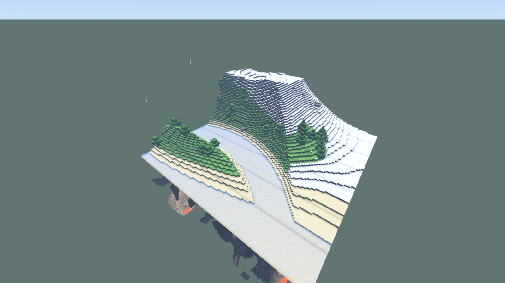
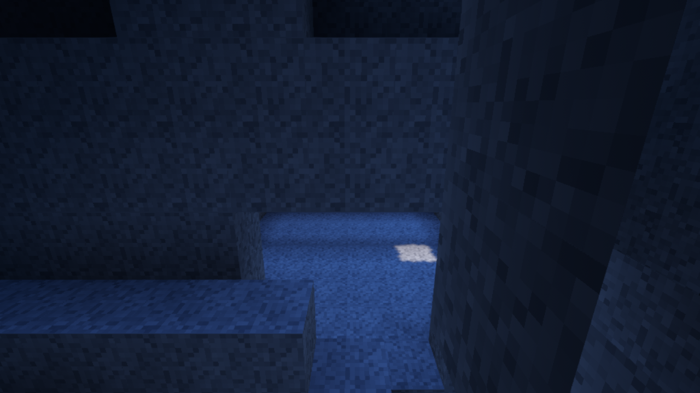
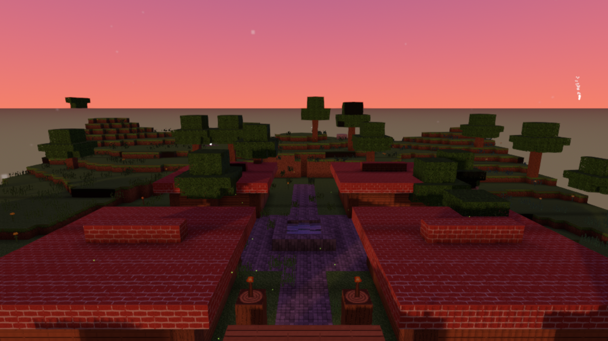

# Minecraft-like

An original, cozy-leaning voxel survival sandbox built with **Godot 4.7.2 .NET** and **C#**. Explore a streamed procedural world, gather and craft, build, survive the night, discover villages and dungeons, and make a place of your own.

The project uses original procedural materials and audio. It is Minecraft-inspired, independent, and not affiliated with or endorsed by Mojang or Microsoft.

> **Project status:** active development. The latest published build is [v1.1.0-beta.1](https://github.com/firasotoom85-droid/minecraft-godot/releases/tag/v1.1.0-beta.1). The default branch may contain changes newer than that release.

## Screenshots

  
  
  

## Highlights

- Infinite, seeded chunk streaming with versioned world generation, multiple biomes, rivers, caves, structures and distant terrain LOD.
- Greedy opaque meshing, a per-face comparison path, pooled mesh payloads and bounded streaming memory.
- Survival systems for health, hunger, equipment, crafting, cooking, farming, fishing, fluids, boats and storage.
- Passive herds, hostile creatures, village residents, trading, quests, dungeons and the Ember Warden encounter.
- Baked voxel lighting, day/night, weather, underwater fog blending and six graphics-quality presets.
- Multi-world saves with atomic writes, rotating backups, import/export and compatibility for older worlds.
- Keyboard and controller rebinding, minimap, achievements journal, contextual onboarding, photo mode and a developer console.

Autosaving captures an immutable save snapshot on the main thread; serialization and the three ordered atomic file writes run on the background save worker, so `_Process()` does not serialize or perform disk I/O. Explicit save and quit flush older work before writing the latest state synchronously.

See the [documentation index](docs/README.md) for subsystem details, test procedures, visual references and historical engineering reports.

## Requirements

- **Godot 4.7.2 .NET / Mono editor**. The standard non-.NET editor cannot build this C# project.
- **.NET 10 SDK**. The repository pins the SDK feature band in global.json.
- A desktop OS supported by Godot. Vulkan is recommended; the game has quality presets for lower-end hardware.

The project has moved from .NET 9, which reached end of support on November 10, 2026, to .NET 10 LTS. See [setup and toolchain notes](docs/development/SETUP.md).

## Build and run

1. Clone the repository and open its folder with the Godot 4.7.2 .NET editor.
2. Import project resources from the editor, or run:

       godot --headless --editor --path . --import

3. Build the C# project:

       dotnet build -c Debug

4. Run the game:

       godot --path .

Use the Godot executable that matches your installation. On systems where it is not on PATH, pass its full path to the scripts below.

## Test

Run the full headless verification suite:

    GODOT=/path/to/Godot_v4.7.2-stable_mono ./scripts/verify.sh

The script builds Debug and runs the registered suites through the real Godot headless test runner. CI additionally builds Debug and Release with warnings treated as errors and captures the deterministic lighting probe scenarios.

The opt-in benchmark and soak reports separate exact retained array lengths from capacity/key-based estimates for persistent caches, registries and streaming queues. These managed-memory diagnostics are not whole-process or VRAM totals; see the [performance benchmark procedure](docs/PERFORMANCE_BENCHMARKS.md) for the accounting boundaries.

For the longer real-scene survival soak:

    GODOT=/path/to/Godot_v4.7.2-stable_mono bash scripts/soak-survival.sh 3600

See [testing and validation](docs/development/TESTING.md) before changing test infrastructure or interpreting a benchmark.

## Default controls

| Input | Action |
|---|---|
| WASD | Move |
| Mouse | Look |
| Left mouse | Mine / attack |
| Right mouse | Place / use |
| Middle mouse | Pick block |
| Space / Shift | Jump / swim up / sprint / dive |
| 1–9 / mouse wheel | Select hotbar slot |
| E / Esc | Inventory / pause |
| M / [ / ] | Minimap / zoom |
| P / J / H | Photo mode / achievements journal / help |
| F3 / F6 | Information panel / quality preset |
| F7 / F8 / F9 | View distance down / up / mute |
| / | Developer console |

Keyboard and controller bindings can be changed in **Esc → Controls**.

## Repository layout

| Path | Purpose |
|---|---|
| scripts/ | C# gameplay, world, streaming, rendering coordination and persistence systems |
| scenes/ | Main menu, gameplay and reusable scene resources |
| shaders/ | Custom voxel surface shaders |
| tests/ | Headless suites and deterministic visual-capture scenes |
| docs/ | Architecture, development guides, benchmarks, audits and visual references |
| addons/ | Editor and development add-ons, each retaining its own license |

## Contributing

Read [CONTRIBUTING.md](CONTRIBUTING.md), the [architecture guide](docs/architecture/ARCHITECTURE.md) and the [current roadmap](ROADMAP.md) before making changes. Compatibility rules for persisted IDs, save data and world generation are mandatory.

## Project documents

- [Documentation index](docs/README.md)
- [Architecture](docs/architecture/ARCHITECTURE.md)
- [Data and lifecycle invariants](docs/architecture/DATA_LIFECYCLE.md)
- [Development setup](docs/development/SETUP.md)
- [Testing](docs/development/TESTING.md)
- [Code style](docs/development/CODE_STYLE.md)
- [Adding content safely](docs/development/ADDING_CONTENT.md)
- [Release process](docs/development/RELEASING.md)
- [Roadmap](ROADMAP.md)
- [Project decisions](PLAN.md)
- [Changelog](CHANGELOG.md)
- [Security policy](SECURITY.md)
- [Third-party notices](THIRD_PARTY_NOTICES.md)

## License

Project code and documentation are licensed under the [MIT License](LICENSE). Bundled third-party components and assets retain their own terms; see [THIRD_PARTY_NOTICES.md](THIRD_PARTY_NOTICES.md).
