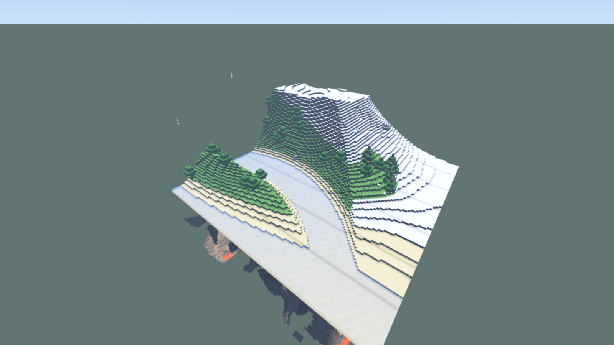
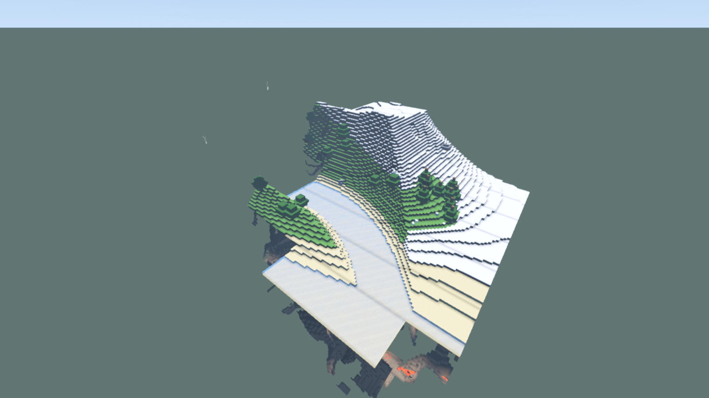
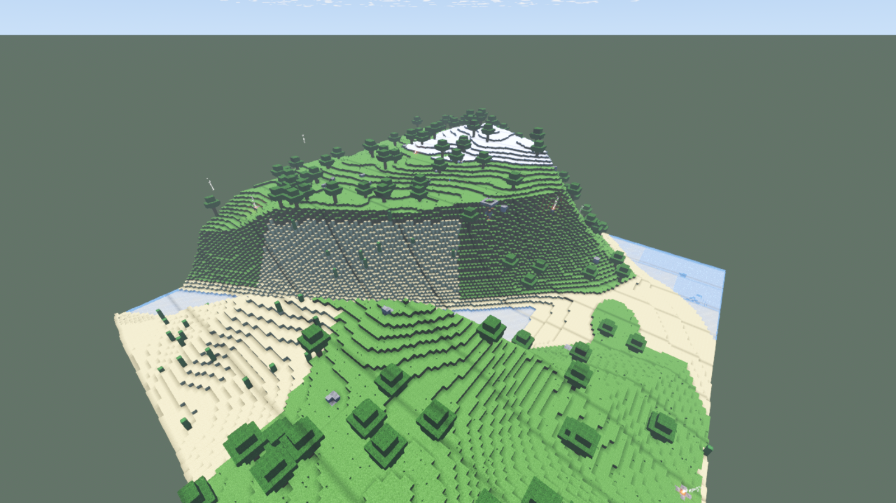
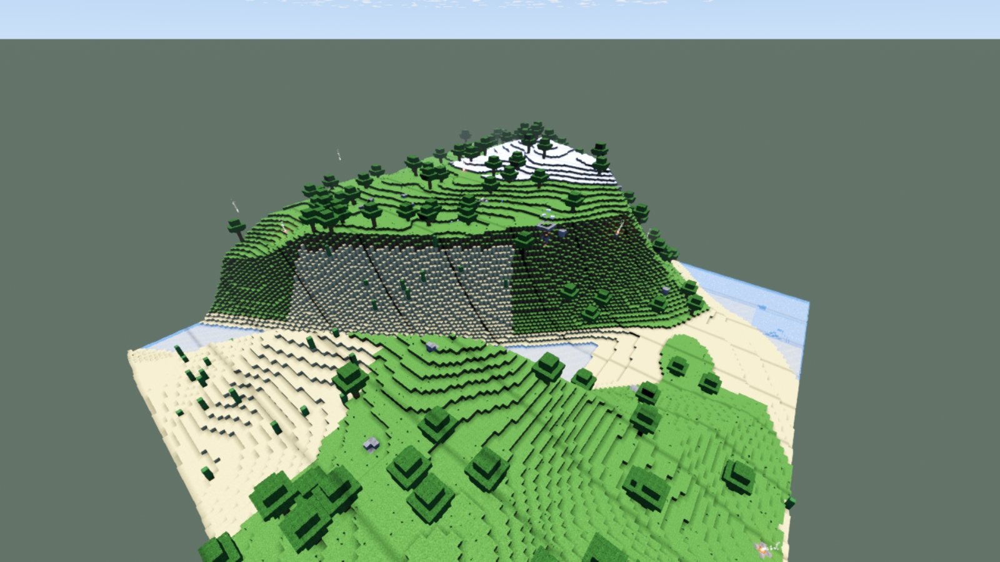

# Visual quality pass — environment and water

**Implementation branch:** `visual/milestone-4-environment-polish`
**Engine:** Godot 4.7.2 .NET / C#
**Baseline:** `main` at `55d79087af6a0caade435f18ae7a6a60d66bfdca`

This increment addresses the environment-rendering portion of Milestone 4. It
extends the existing day/night, weather, and water systems; it does not add a
second environment controller, a new water renderer, or replacement scene
systems.

## Changes

### Day/night atmosphere

- Added a deterministic sky palette evaluator used by the existing
  `DayNight` node. Dawn and dusk now receive their own warm horizon envelope,
  while the upper sky, ground horizon, daylight, night, cloud response, ambient
  energy, sun/moon energy and air-fog multiplier stay in one testable calculation.
- Overcast blends retain a readable horizon instead of flattening the entire
  sky to one grey. Lightning uses the same palette and temporarily lifts the
  sky and ambient response.
- The existing biome fog tint, underground darkness, underwater fog, stars,
  cloud meshes, caustic frames and voxel-light energy application remain in
  their current systems.

### Precipitation and biome transitions

- The existing weather node now refreshes the rain/snow biome choice when the
  player enters a different integer world column. It reuses the cached biome
  result while the player remains in that column, rather than re-querying the
  same terrain cell every frame.
- Weather state probabilities, duration ranges, particle emitters, lightning,
  sound hooks and ground-wetness presentation remain in the existing system.

### Water presentation

- Water now calculates camera-space depth from its transformed world-space
  vertex after the existing top-surface wave displacement. This avoids using
  chunk-local vertex coordinates with the global view matrix, which made
  shoreline depth fade and distance-based ripple damping dependent on chunk
  placement.
- Added low-amplitude procedural shoreline foam using the existing water
  shader and material. No new scene nodes, textures, particle emitters or
  rendering paths were introduced.

## Visual capture

The new `AtmosphereVisualCapture.tscn` runner loads the real game scene,
hides the existing HUD for clean review frames, creates a disposable world with a fixed seed and generator version, applies a
fixed time/weather state, waits for streaming, and saves a GPU-rendered PNG.
The temporary world is removed after capture.

Example (run with the project's Godot 4.7.2 .NET editor binary):

```bash
godot --path . res://tests/AtmosphereVisualCapture.tscn -- \
  1337 8 512 -372 0.50 Clear \
  res://docs/visual/screenshots/atmosphere-river-valley-noon-clear.png
```

Arguments are seed, generator version (1–current supported version), world X, world Z, time of day
(0–1), weather (`Clear`, `Cloudy`, or `Rain`), and output PNG path. Storm is
intentionally excluded from this deterministic capture runner because its
lightning timing is random. Use matching coordinates and vary time/weather to
build a comparison set. For representative V8 locations, see
[`docs/worldgen/V8_VISUAL_VALIDATION.md`](worldgen/V8_VISUAL_VALIDATION.md).

### Captured samples

**Frozen V8 baseline**



- Seed 1337, generator V8, centre (512, -372), midday, clear weather.
- Godot 4.7.2 .NET, Vulkan Forward+, NVIDIA GeForce MX230.
- 1600 × 900; 49 streamed chunks; capture completed successfully.

**Current V9 generator**



- Same seed, centre, time and weather, using the current generator V9.
- 1600 × 900; 40 streamed chunks; capture completed successfully.
- The capture runner supports all persisted generator versions V1–V10. These
  screenshots compare two generator versions under the same viewing conditions;
  this PR does not modify either generator's output.

These are rendered reference frames, not a sign-off for every biome, weather
state, camera angle, or graphics preset. The remaining manual matrix should
cover dawn/noon/sunset/night in plains and forest, snow precipitation in a
snow biome, desert colour response, mountain horizons, cave entrances and
deep caves, village interiors/exteriors, clear/rain/storm weather, and
above-water/underwater water views on LOW and HIGH presets. The existing
V8 world-generation capture set remains the baseline for terrain shape.

## Compatibility and scope boundaries

- No `BlockId` or `ItemId` values were added, changed, reordered or reused.
- No world-save fields or save versions changed.
- No generator source or output was changed by this rendering-only
  increment. The capture runner accepts existing generator versions V1–V10; the
  committed reference frame intentionally uses V8 for comparison with the
  existing V8 visual baseline.
- Voxel mutation, packed voxel-light propagation, greedy meshing, chunk
  streaming and far-LOD generation were not replaced.
- No third-party textures, models, sounds, or proprietary game assets were
  added.
- Material/texture consistency work already in separate open PRs remains
  separate; this branch does not duplicate their BlockDb, meshing, far-LOD or
  atlas edits.

## Validation

Record results for the exact commit under review:

- Debug build: Godot 4.7.2 .NET / .NET 9; 0 warnings, 0 errors.
- Release build: `dotnet build minecraft.csproj -c Release`; 0 warnings,
  0 errors.
- Headless regression suite on the rebased current main: **153,482 checks,
  0 failures**, including the merged benchmark, streaming, graphics, material,
  glass, V9 weathering and existing gameplay suites.
- Real-scene Forward+ captures: PASS on MX230 for V8 (49 chunks) and V9
  (40 chunks), both at 1600 × 900; water shader compiled and rendered.

The screenshot runner emitted the project's existing missing-script-UID
fallback warnings in this fresh worktree; Godot resolved the tracked scene
script paths and completed the capture. The harness now accepts all supported
generator versions on current main (V1–V10); the committed reference remains
V8 so it can be compared against the project's existing V8 visual baseline. The headless save suite also logs its
expected failed-write and backup-recovery warnings while testing those error
paths. Neither is reported as a clean, warning-free runtime launch.

## Follow-up — shared distance haze (2026-11-22)

The V8 environment's reduced exponential air density improved general clarity,
but it did not provide independent control over near-field visibility and
distant mountain attenuation. The follow-up keeps the existing environment and
day/night ownership and switches V8+ outdoor views to Godot's built-in depth
fog:

- Begin: 96 m; end: 330 m; depth curve exponent: 2.2; clear density: 0.42.
- The existing day/night cloud multiplier is retained and clamped to a maximum
  density of 0.68, preventing overcast weather from creating a solid fog wall.
- The shared scene environment applies the same camera-depth ramp to streamed
  chunk meshes and far LOD. Fog is not restarted per chunk or baked into vertex
  colour, so the transition has no chunk-size dependency.
- V1–V7 keep their original exponential fog. DayNight switches caves back to
  exponential darkness, and Player keeps underwater/lava camera overrides
  exponential. MenuBackdrop explicitly retains its authored exponential
  profile.
- LOW and BALANCED still disable volumetric fog; ordinary depth haze remains
  active without creating local lights, FogVolume nodes, or additional scene
  nodes.

### Repeatable mountain comparison

Run both states with the same arguments and change only the environment code.
The capture fixture waits for every chunk in the requested square; view distance
5 produces 121 streamed chunks and avoids using the stream boundary as the
inspection horizon.

```bash
godot --path . res://tests/AtmosphereVisualCapture.tscn -- \
  777 11 -424 760 0.50 Clear \
  res://docs/visual/screenshots/distance-haze-v11-mountain-after.png false 5
```

The before frame was captured from the unchanged main environment factory
and DayNight implementation at baseline commit b7a4dd9; the after frame uses
the depth-fog profile above. Both are Godot 4.7.2 .NET, Forward+ / Vulkan,
NVIDIA GeForce MX230, 1600×900, seed 777, generator V11, centre (-424, 760),
noon and clear weather. Both completed the 121-chunk stream; the capture
settled in 471 frames before and 470 after. This frame count is not an FPS
benchmark.

| Original exponential fog | Shared distance haze |
|---|---|
|  |  |

A pixel comparison shows the sky is effectively unchanged; most visible
difference is concentrated in the terrain and distance/horizon regions.
The close slopes retain texture contrast while the far ridge and tree line
blend more softly into the background. This is one repeatable mountain view,
not full visual sign-off for all biomes, weather, times of day or graphics
presets.

### Compatibility and verification

This is rendering-only. No BlockId/ItemId values, world/save versions,
generator source or output, mutation path, packed lighting, greedy meshing,
chunk streaming or far-LOD generation changed. V1–V8 remain frozen.
dotnet build -c Debug completed with 0 warnings / 0 errors, and
scripts/verify.sh passed 189,988 checks / 0 failures across 46 suites.
The real-scene comparison streamed 121 chunks on the MX230. The capture's
fresh-worktree scene UID fallback warnings and the save tests' deliberate
failure/recovery warnings are existing validation-harness behavior.
