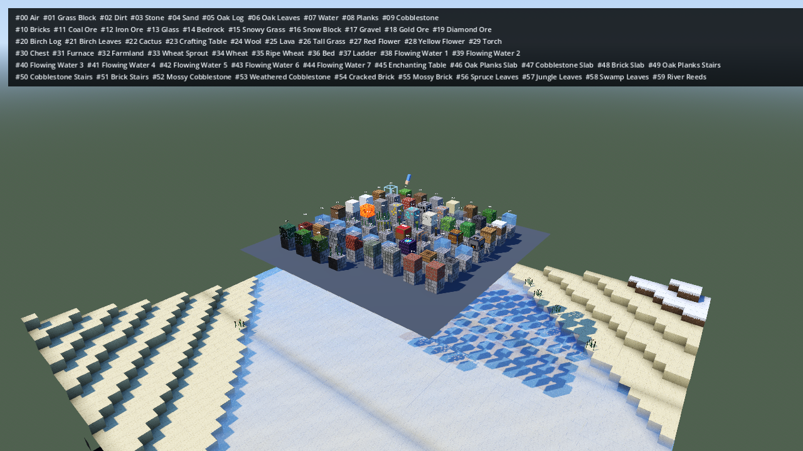
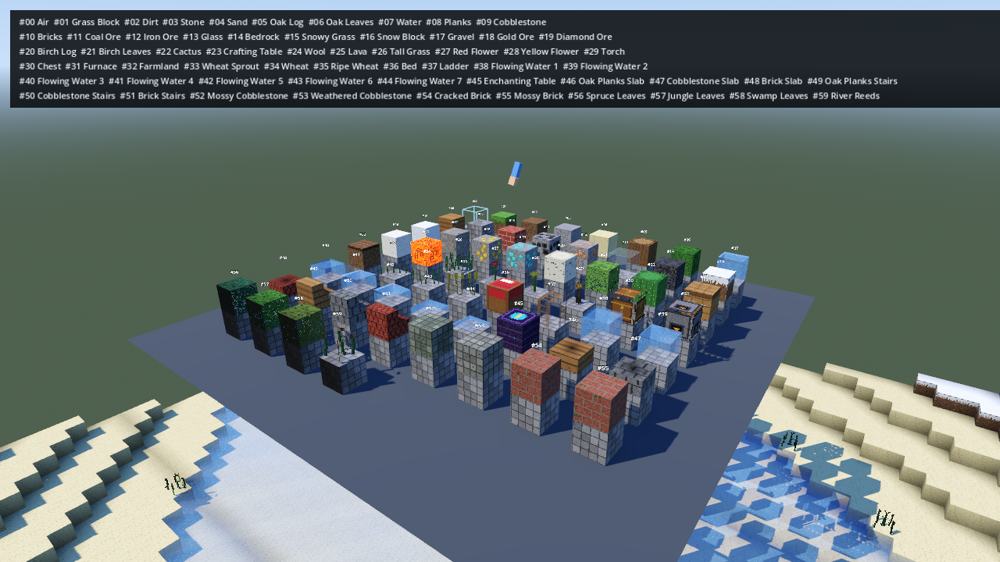
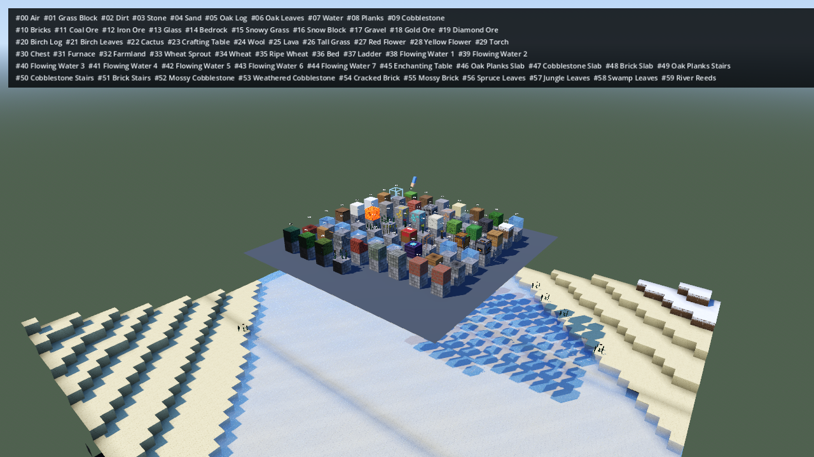

# Material gallery visual-quality report — 2026-11-22

## Scope and comparison method

The production block-art pipeline was already present before this change: the
procedural packed atlas, classic atlas shader, greedy texture-array shader,
isolated per-tile mip chains, material-response families, and first-person item
icon/response routing are reused without changing their authored data.

This report compares the two existing renderer paths with the same registered
block samples and a locked scene profile:

- **Before — classic atlas:** `Settings.GreedyMeshing = false`; faces sample the
  packed atlas through the existing classic atlas material.
- **After — greedy texture array:** `Settings.GreedyMeshing = true`; merged
  faces use the existing per-tile texture-array layers and isolated mipmaps.

This is a renderer/sampling comparison, not a claim that the source tile art was
redrawn. Both captures intentionally retain identical block IDs, atlas tile
coordinates, UV mapping, material families, lighting response and sample
positions. The updated camera composition and smaller neutral stage are shared
by both sides so they cannot bias one renderer's result.

## Reproducible capture profile

| Setting | Value |
|---|---|
| Engine / renderer | Godot 4.7.2 .NET, Vulkan Forward+ |
| Test GPU | NVIDIA GeForce MX230, 4 GB |
| Resolution | 1280 × 720 |
| Seed | 1337 |
| World generator | Current generator V11; no generation rules changed |
| Gallery | 60 registered BlockIds, 8 columns, 8 rows |
| World target | `(8.5, 54.55, 8.5)` |
| Close camera offset | `(12, 8, 16)` from target |
| Distant camera offset | `(22, 15, 28)` from target |
| Camera FOV / far clip | 55° / 180 m |
| Stage | 20 × 20 m neutral plane |
| Legend | 112 px high, 10 px text |
| Key light rotation | `(-48°, -35°, 0°)` |
| Key light color / energy | `(1.0, 0.97, 0.91)` / 1.15 |
| Key light shadow range / bias | 80 m / 0.04; normal bias 1.0 |
| Ambient energy | 1.0 |
| Environment | Fog, volumetric fog, SSR and glow off; SSAO on |
| Streaming state at capture | 9 loaded chunks; 0 pending payloads |

The runner logs the exact target and profile at startup. Each path was launched
with the same scene and seed, and only the final renderer argument (`atlas` or
`greedy`) differed. The captures were generated on the MX230 using the Godot
4.7.2 .NET official build `4.7.2.stable.mono.official.ed1daf0bf`.

## Before — classic packed atlas

### Close view

### Distant view

## After — greedy texture array

### Close view

### Distant view

## Observations

**Composition, compared with the previous committed gallery frames.** The old
`material-gallery-close.png` and `material-gallery-distant.png` references used
a 120 × 120 m stage and a 198 px legend panel. The stage occupied most of the
world view while the material samples were comparatively small. The new 20 m
stage is only slightly larger than the 15 m sample grid, and the legend panel is
112 px high. The 60 samples now occupy a much larger fraction of the frame,
while terrain around the stage remains visible as context. The six legend rows
remain complete and the ID markers stay available in the gallery.

**Close-range renderer parity.** The atlas and greedy close captures retain the
same recognizable colors, face patterns, transparency/cutout silhouettes and
material-family response. At this distance the images are visually very close;
that is expected because the comparison deliberately holds the source tiles and
material definitions constant. No atlas tile shift or first-person icon mapping
change is involved.

**Distant material coherence.** Both distant captures keep the complete sample
layout and major material identities readable at the reduced projection size.
The greedy path continues to use the pre-existing isolated per-tile mip chains,
which avoid sampling neighboring atlas tiles when the texture-array path minifies
a face. Fine 32 px tile details naturally become less distinct at this distance;
the comparison does not justify claiming a perceptible performance or
pixel-level quality gain on every material. No gross cross-tile color bleed or
material-family mismatch was apparent in this MX230 review.

**Lighting and tonal consistency.** The fixed warm-neutral key light, ambient
fill and shared material response preserve separation between stone, wood, soil,
foliage, glass, ore and water samples in both views. Glass/water remain
translucent, cutout vegetation retains its silhouette, and bright snow/sand do
not require a renderer-specific palette adjustment in this gallery setup.

**Assets.** No external art was introduced. Existing tiles remain the project's
procedurally authored atlas content; no proprietary Minecraft texture, model or
sound was copied.

## Verification and runtime impact

- `dotnet build -c Debug`: passed, 0 warnings and 0 errors.
- `scripts/verify.sh` with Godot 4.7.2 .NET: passed, **189,856 checks and 0
  failures**.
- Real-scene atlas and greedy runs: both exited successfully; both rendered
  1280 × 720 close and distant PNGs; each settled at 9 chunks and 0 pending
  payloads before capture.
- Focused gallery tests now lock capture resolution, FOV, both camera offsets,
  far clip, stage and legend dimensions, key-light direction/color/energy,
  shadow distance/bias, ambient energy and environment feature toggles. Existing
  tests continue to validate all
  registered IDs, atlas UV bounds, texture-array layer/mipmap count, material
  response ranges and first-person atlas icon routing.
- The change adds no runtime gameplay work. Only the opt-in test gallery uses
  the smaller stage and locked profile; no production scene, shader, texture,
  mesh, collision or per-frame path was changed. The capture fixture continues
  to disable collision, cap mesher concurrency at two and use the existing
  chunk streamer. No standalone FPS or GPU-time benchmark was performed.

## Compatibility and remaining caveats

No persisted BlockId or ItemId was added or reordered; save formats and world
generation rules are unchanged. V1–V8 remain frozen, and the gallery's
disposable world uses the current generator only to obtain a safe display
location. All placed samples and pedestals still go through
`VoxelWorld.SetBlock`. Air and Bedrock remain non-world preview geometry for
the existing API constraints. Greedy meshing and chunk streaming are unchanged.

These images are hardware/driver captures rather than a universal colorimetric
benchmark. GPU, driver, display calibration and window scaling can change the
appearance slightly on other systems. Close and distant camera transforms,
resolution and principal light settings are fixed and automated-tested so later
captures can be compared consistently. The two renderer images are
qualitatively close; use the exact capture commands in the README when a new
engine/shader/material change warrants another comparison.

## Previous composition references

These are the original committed close/distant shots, retained for comparison
with the revised gallery framing (they are not the matched renderer A/B pair):

- [Previous close capture](screenshots/material-gallery-close.png)
- [Previous distant capture](screenshots/material-gallery-distant.png)
