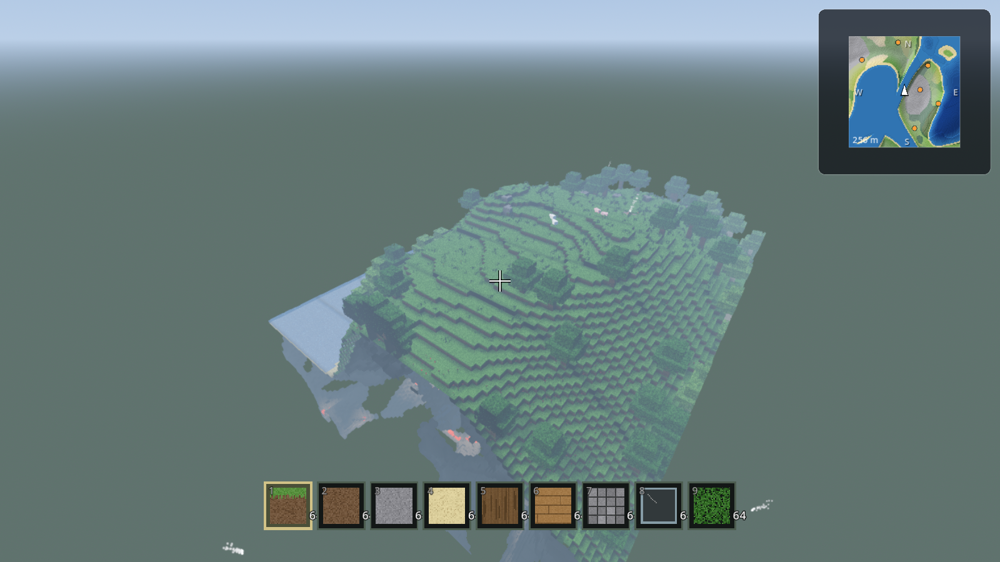
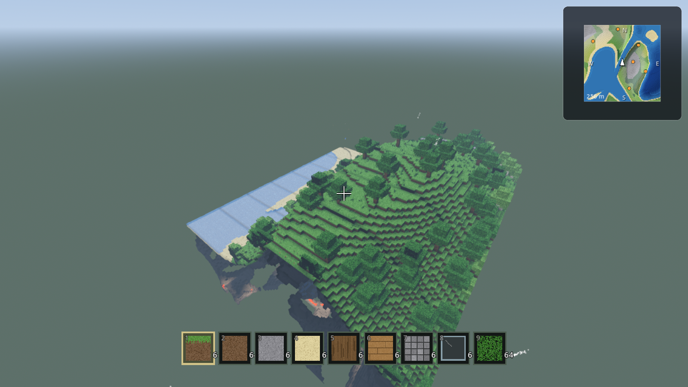
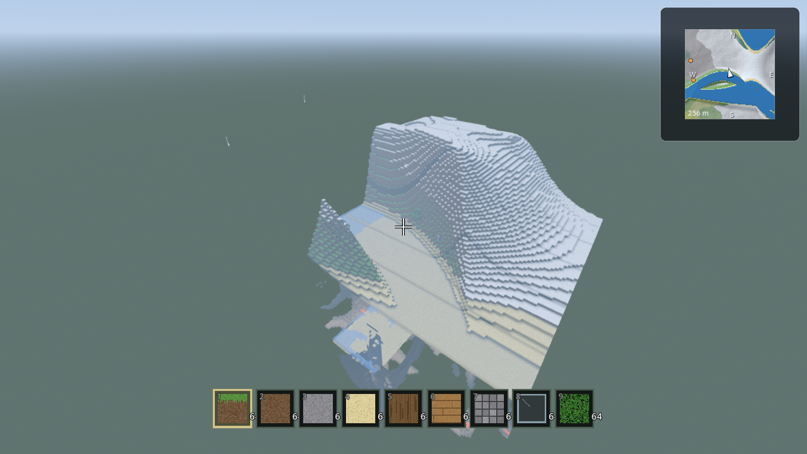
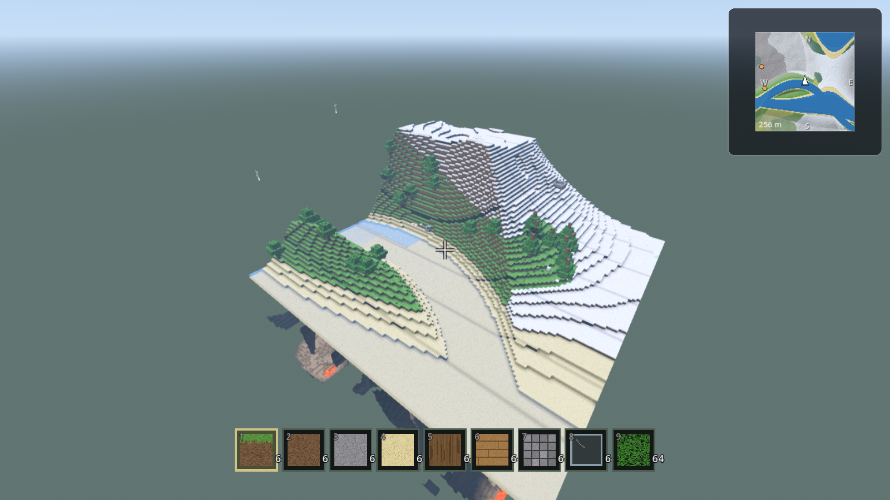
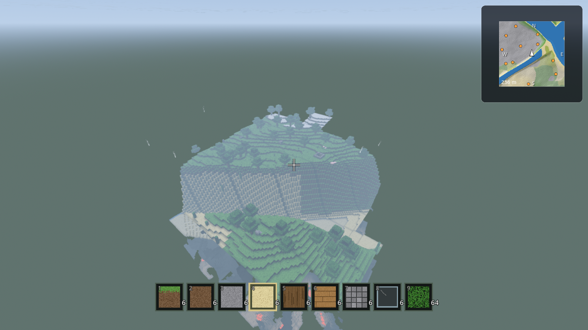
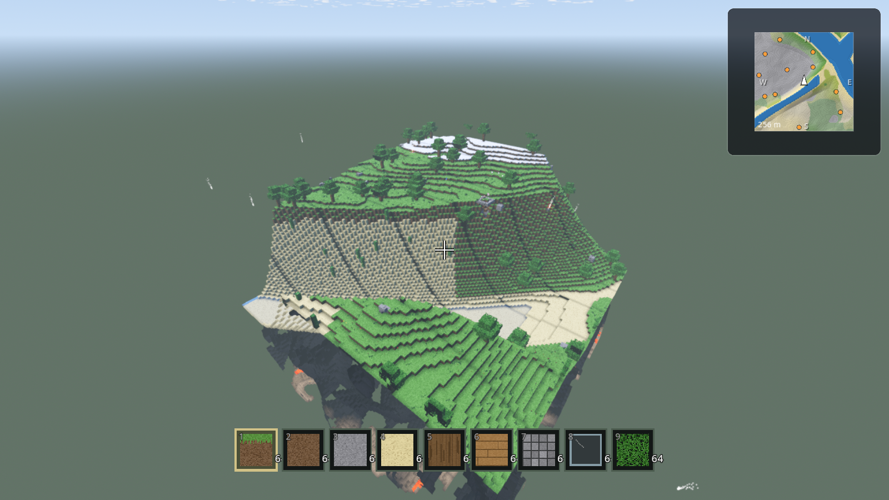
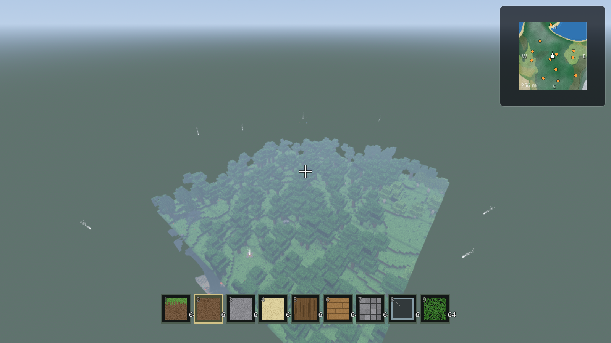
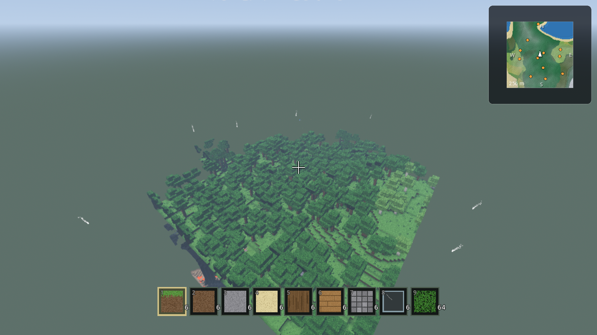
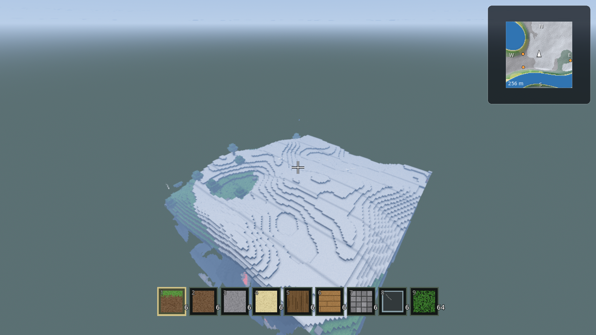
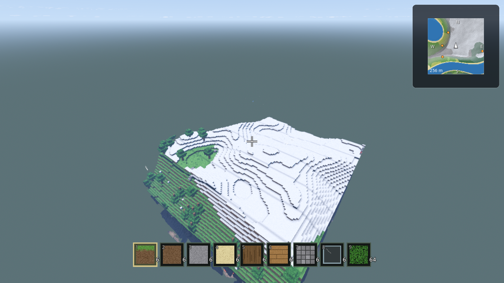

# World generation V8 — visual validation

**Runtime:** Godot 4.7.2 .NET stable  
**Renderer:** Forward+ / Vulkan  
**GPU:** NVIDIA GeForce MX230  
**Capture resolution:** 1600 × 900  
**Baseline:** generator V7 at the same seed and world coordinate as each V8 capture

The screenshots were captured from the real scenes/main.tscn game scene after surrounding chunks streamed in. They are not heightmap previews or offline terrain renders.

## Before / after captures

### Steep river-bank transition

Seed 11235813, world coordinate (-128, -488). The adjacent sample is 8 blocks east.

| V7 | V8 |
|---|---|
|  |  |

The sampled surface step changes from 38 blocks (41 → 79) to 18 blocks (43 → 61). The new response preserves the same seed-derived river field while widening the bank transition.

### River valley / water transition

Seed 1337, coordinate (512, -372).

| V7 | V8 |
|---|---|
|  |  |

### Mountain silhouette and elevation

Seed 777, coordinate (-424, 760).

| V7 | V8 |
|---|---|
|  |  |

The terrain field and mountain placement remain V7-derived; V8 changes the bank response and atmospheric treatment rather than replacing the mountain system.

### Forest density and distribution

Seed 24681357, coordinate (192, 128).

| V7 | V8 |
|---|---|
|  |  |

The fixed 48 × 48 forest sample contains 82 V7 tree sites and 114 V8 tree sites. Tree placement remains deterministic and uses the existing tree shapes and block materials.

### Cave entrance / underground readability

Seed -90817263, coordinate (-332, -392).

| V7 | V8 |
|---|---|
|  |  |

V8 adds a second shallow entrance field. In the four-seed shallow-depth sample, cave-positive positions increase from 1,910 to 2,009. Existing deeper cave, aquifer, magma and ore rules are reused.

## Lighting evaluation

The rendered V7 forest and mountain baselines showed heavy blue-white atmospheric haze that flattened distant canopy and slope contrast. The first V8 environment-only adjustment did not fully take effect because DayNight rewrote air fog density each frame. The final change makes that runtime fog value generator-version-aware:

- V1–V7 retain their original air-fog density (0.0035).
- V8 uses a lower air-fog density (0.00065) and reduced height / volumetric haze.
- Cave darkness and underwater fog overrides remain in the existing DayNight path.

The final V8 screenshots above were recaptured after correcting this runtime override.

## Automated validation

Godot 4.7.2 .NET build: **0 warnings, 0 errors**.

Latest headless run: **1,213 checks, 0 failures**.

Coverage includes:

- All 13 biomes represented across seeds 1337, 777, 24681357, and -90817263.
- Deterministic V8 chunk output when generation order is reversed.
- Three pinned V7 golden chunk hashes, protecting V7 byte output.
- Tree canopy, ore vein, surface structure and underground structure continuity across chunk seams in both V7 and V8.
- River-bank step, cave entrance count, forest tree density, and V7/V8 fog-profile assertions.

Latest warmed 8-chunk timing sample on the validation machine:

| Generator | Mean chunk data time |
|---|---:|
| V7 | 7.03 ms |
| V8 | 7.33 ms |

This run measured V8 at approximately 4% slower than V7. Timing varies with CPU scheduling and JIT state; the test warms each generator before timing. Chunk streaming and greedy meshing implementations were not changed.

## Scope and remaining manual review

Generator versions 1–7 are retained. The V7 source file is unchanged, its golden hashes are pinned, and existing world format / persisted IDs are not modified. New worlds use generator V8. No block or item IDs were added.

These captures are a representative visual audit, not a complete art-direction sign-off. Ore veins, surface landmarks and underground structures retain their deterministic V7 placement rules and are covered by V7/V8 chunk-seam regression tests, but they do not yet have dedicated close-up GPU screenshots in this report. A biome-boundary close-up and longer exploration routes also remain useful manual follow-up checks; caves should still be reviewed from inside the underground network.
