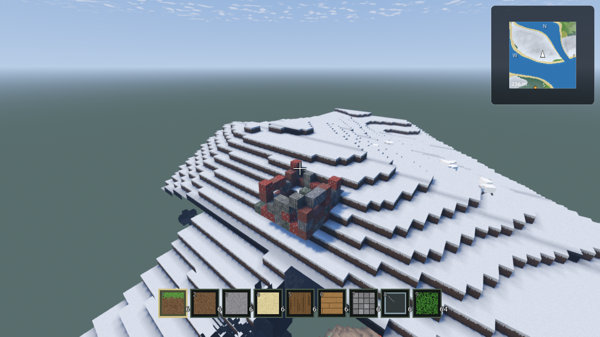
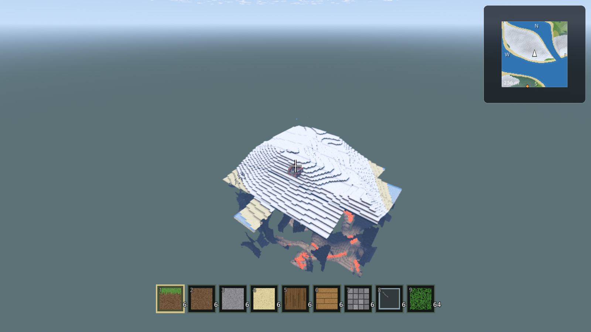

# V9 generated-structure weathering: visual validation

## Scope

V9 applies four deterministic material variants to stonework in the existing V8 surface and underground structure templates: mossy cobblestone, weathered cobblestone, cracked brick and mossy brick. Textures are drawn procedurally into the existing 32×32 atlas tiles. No external texture pack or third-party art is used.

The structure templates, coordinates, site selection, seed consumption and chunk clipping remain the V8 implementation. V9 changes only eligible cobblestone and brick outputs during the existing structure-stamp callback. Generator V1–V8 and save format v4 remain unchanged. Existing V1–V8 worlds do not receive the new appearance retroactively.

## Scene captures

Engine: Godot 4.7.2 stable .NET. Renderer: Vulkan Forward+. GPU: NVIDIA GeForce MX230. Seed: 1337. Ruin site: kind 1 at world coordinate (429, 54, -1893). Captures are 1600×900 and use the real main game scene, existing chunk streamer, normal atlas material path and greedy mesher.

Close view, camera scale 0.20: 16 chunks resident, 476 frames, 13.06 seconds until capture.

Distant view, camera scale 1.00: 29 chunks resident, 442 frames, 10.92 seconds until capture.

The close frame resolves the separate cobble and brick surfaces, including coarse chips, mortar wear, cracks and moss patches. At the distant camera scale, the 7×7 ruin silhouette remains readable and the red/brown brick versus gray stone material grouping survives the reduced screen footprint, although individual crack and moss marks naturally merge into the block-level colour at this distance. These captures inspect streamed chunk meshes with the capture scene's LOD radius disabled; they are not evidence that the separate far-terrain LOD renders structure geometry.

## Performance and compatibility

Weathering is selected only while deterministic structures are stamped. The selection uses the site seed, a salted integer coordinate hash and 2×2×2 coordinate grouping; it does not add per-frame work, physics, scene nodes, mesh surfaces or texture allocations. The four 32×32 tiles are generated once with the existing atlas. The new definitions remain ordinary opaque full cubes, so greedy meshing, chunk streaming and material lookup need no special cases.

The focused regression suite recorded a single same-site two-chunk sample of 12.01 ms/chunk for V8 and 11.29 ms/chunk for V9. This short diagnostic is too small to claim a general performance improvement; it showed no additional generation cost in that run. The stronger performance guarantee is structural: the hash runs only for eligible structure-stamp cells, not per frame.

Block IDs 52–55 and item IDs 101–104 are appended after every previously persisted value. World format remains v4. V8/V9 regression checks compare generated chunk bytes and assert that every V9 difference is a matching stone/brick material substitution; the same suite checks reversed chunk-generation order.

## Reproduction

Run the close capture with:

    godot --path . res://tests/WorldgenVisualCapture.tscn -- 1337 9 429 -1893 res://docs/worldgen/screenshots/v9-close.png 0.2

Change the final camera scale to 1.0 for the distant framing. The scale is clamped to 0.2–2.0. Run the full headless suite with scripts/verify.sh and the Godot 4.7.2 .NET executable.

The visual-capture scene currently prints existing invalid-resource-UID fallback warnings for several main-scene C# references and resolves them by their explicit res:// paths; the captured scenes still load and render successfully.